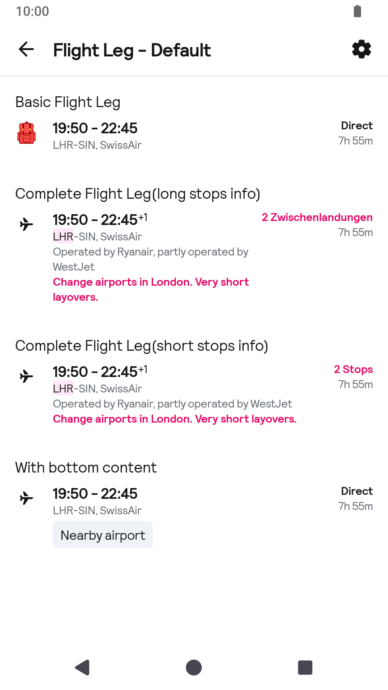
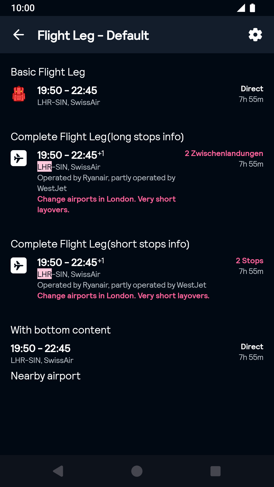

# FlightLeg

[](https://search.maven.org/artifact/net.skyscanner.backpack/backpack-compose)
[](https://backpack.github.io/android/backpack-compose/net.skyscanner.backpack.compose.flightleg)
[](https://github.com/Skyscanner/backpack-android/tree/main/backpack-compose/src/main/kotlin/net/skyscanner/backpack/compose/flightleg)

## Default

| Day                                                                                                                                                                    | Night                                                                                                                                                                                 |
|------------------------------------------------------------------------------------------------------------------------------------------------------------------------|---------------------------------------------------------------------------------------------------------------------------------------------------------------------------------------|
|  |  |

## Installation

Backpack Compose is available
through [Maven Central](https://search.maven.org/artifact/net.skyscanner.backpack/backpack-compose). Check the
main [Readme](https://github.com/skyscanner/backpack-android#installation) for a complete installation guide.

## Usage

| Parameter | Description |
|---|---|
| `bottomContent` | **Experimental.** Optional content below the airport codes, aligned with their start edge. Defaults to `null`. |

Pass `bottomContent` by name. A trailing lambda continues to supply `carrierLogoContent`, preserving existing callers.

### Experimental bottom content accessibility

Bottom content is placed in the flight-details column after the airport codes with
a `BpkSpacing.Sm` gap, before the operator and warning notices. It aligns with the
codes in both layout directions, whether or not a carrier logo is present. It is
inside the flight leg's merged semantics: supply non-interactive content only. When `contentDescription`
is `null`, the complete leg including bottom content is hidden from TalkBack. When it
is set, TalkBack reads that description as the leg's single focus target, so callers
must append the bottom-content text to `contentDescription` themselves.

```Kotlin
@OptIn(ExperimentalBackpackApi::class)
BpkFlightLeg(
  departureArrivalTime = "19:50 - 22:45",
  description = AnnotatedString("LHR-SIN"),
  stopsInfo = "Direct",
  duration = "7h 55m",
  contentDescription = "19:50 to 22:45. Direct. 7 hours 55 minutes. Nearby airport",
  bottomContent = { BpkText(text = "Nearby airport") },
)
```

Example of a FlightLeg:

```Kotlin
import net.skyscanner.backpack.compose.flightleg.BpkFlightLeg

BpkFlightLeg(
  departureArrivalTime = "19:50 - 22:45",
  description = buildAnnotatedString {
    withStyle(
      bpkAirportHighlightStyle()
    ) {
      append("LHR")
    }
    append("-SIN, SwissAir")
  },
  stopsInfo = "2 Stops",
  highlightStopsInfo = true,
  duration = "7h 55m",
  nextDayArrival = "+1",
  operatedBy = "Operated by Ryanair",
  warning = "Change airports in London",
  contentDescription = null,
  carrierLogoContent = {
    BpkIcon(icon = BpkIcon.Aircraft, contentDescription = null)
  },
)
```
