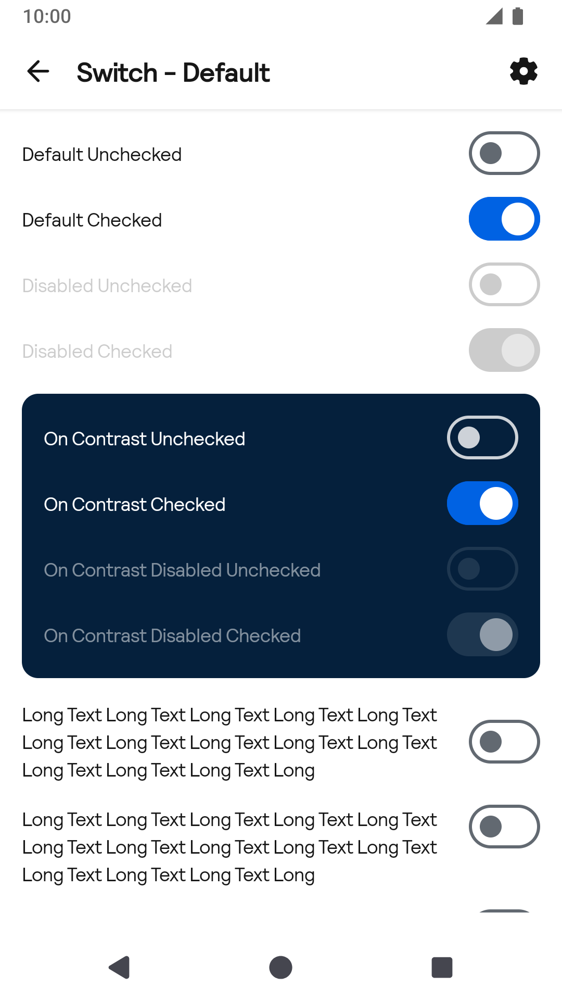
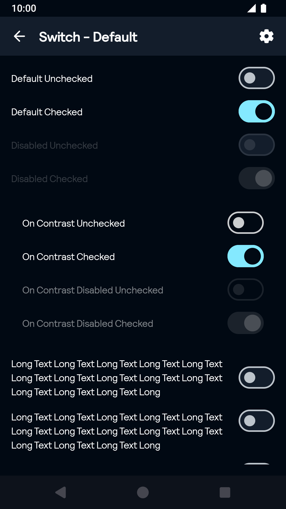
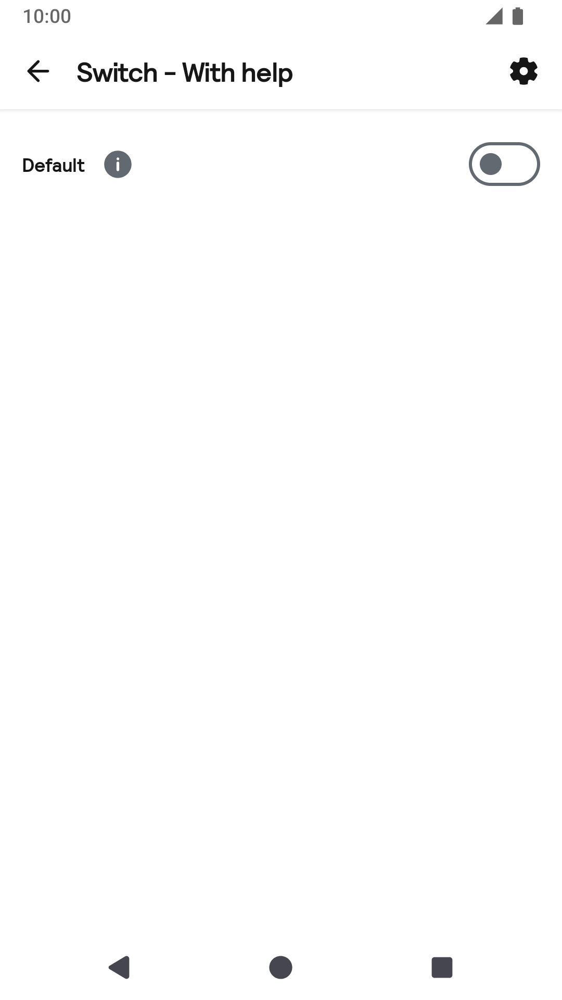
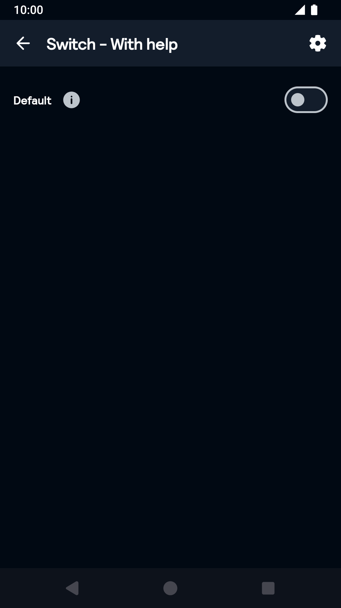

Is # Switch

[](https://search.maven.org/artifact/net.skyscanner.backpack/backpack-compose)
[](https://backpack.github.io/android/backpack-compose/net.skyscanner.backpack.compose.switch)
[](https://github.com/Skyscanner/backpack-android/tree/main/backpack-compose/src/main/kotlin/net/skyscanner/backpack/compose/switch)

## Default

| Day | Night |
| --- | --- |
|  | |

## Installation

Backpack Compose is available through [Maven Central](https://search.maven.org/artifact/net.skyscanner.backpack/backpack-compose). Check the main [Readme](https://github.com/skyscanner/backpack-android#installation) for a complete installation guide.

## Usage

| Parameter | Description |
|---|---|
| `helpAction` | **Experimental.** Accessible trailing help button outside the switch toggle target. |

```Kotlin
@OptIn(ExperimentalBackpackApi::class)
BpkSwitch(
  text = "Switch text",
  checked = true,
  onCheckedChange = { },
  helpAction = BpkSwitchHelpAction(contentDescription = "Help", onClick = { }),
)
```

### Help sheet consumer contract

`helpAction` opens consumer-owned help. For a font-scaling sheet title, pass no
`title` to `BpkModalBottomSheet`; retain its `closeButton` and render the title as a
`BpkTheme.typography.heading5` heading in a scrollable content slot. This avoids the
shared modal header's intentionally unscaled title while keeping the close control
visible and accessible. Use caller-localised text for the help label, title, message,
and close content description.

The help touch target sits next to the label; the centred icon provides visual spacing.
Help remains enabled when the switch is disabled because it is informational. The help
target is vertically centred, and the switch follows the requested switch alignment.

For the experimental help overload, a caller `modifier` decorates the whole help-row
layout. It does not identify the nested Switch semantics node: use the switch label to
query that node in Compose tests. This preserves the help button as a sibling rather
than extending the switch toggle target over it.

The visual switch can still be tapped, but the space between the help target and switch
is deliberately outside both actions so the help button remains outside the switch
toggle target. The visual-switch tap uses no separate keyboard focus or accessibility
node; it also has no independent pressed-state indication.

Example of a Switch:

```Kotlin
import net.skyscanner.backpack.compose.switch.BpkSwitch

BpkSwitch(
  text = "Switch text",
  checked = true,
  onCheckedChange = { checked -> },
)
```

Example of a Switch with annotated string:

```Kotlin
import androidx.compose.ui.text.buildAnnotatedString
import net.skyscanner.backpack.compose.switch.BpkSwitch

BpkSwitch(
  text = buildAnnotatedString {
    append(stringResource(R.string.toggle_long_text))
    withStyle(
      style = SpanStyle(
        color = BpkTheme.colors.coreAccent,
        fontFamily = BpkTheme.typography.bodyDefault.fontFamily,
      ),
    ) {
      append(" styled text")
    }
  },
  checked = true,
  onCheckedChange = { checked -> },
)
```

Example of a Switch with OnContrast style and custom text style:

```Kotlin
import net.skyscanner.backpack.compose.switch.BpkSwitch
import net.skyscanner.backpack.compose.switch.BpkSwitchStyle

BpkSwitch(
  text = "Switch text",
  checked = true,
  onCheckedChange = { checked -> },
  style = BpkSwitchStyle.OnContrast,
  textStyle = BpkTheme.typography.heading5,
)
```

Example of a Switch with custom content:

```Kotlin
import net.skyscanner.backpack.compose.switch.BpkSwitch

BpkSwitch(
  checked = true,
  onCheckedChange = { checked -> },
) { checked ->
  MyCustomContent()
}
```

## Accessibility

`BpkSwitch` announces its checked state ("On"/"Off") to TalkBack before its label. If the checked state is always the same in a given context, that announcement is redundant and can be confusing. Pass `announceState = false` to suppress it.

For external keyboards, `BpkSwitch` is a single Tab stop: only the row that wraps the label and the switch registers a focus target, not the switch control by itself.

### Switch with help

| Day | Night |
| --- | --- |
|  |  |
