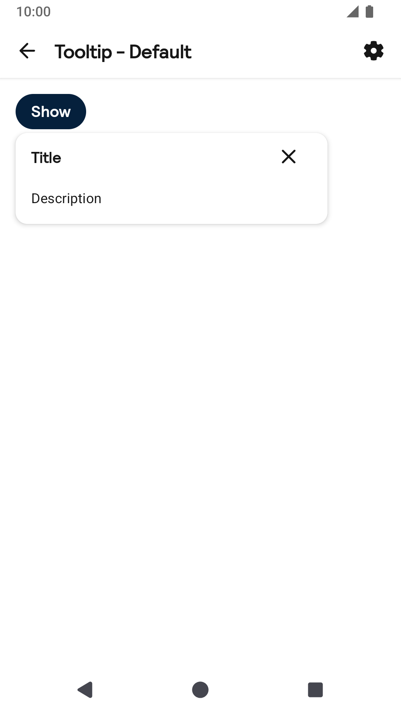
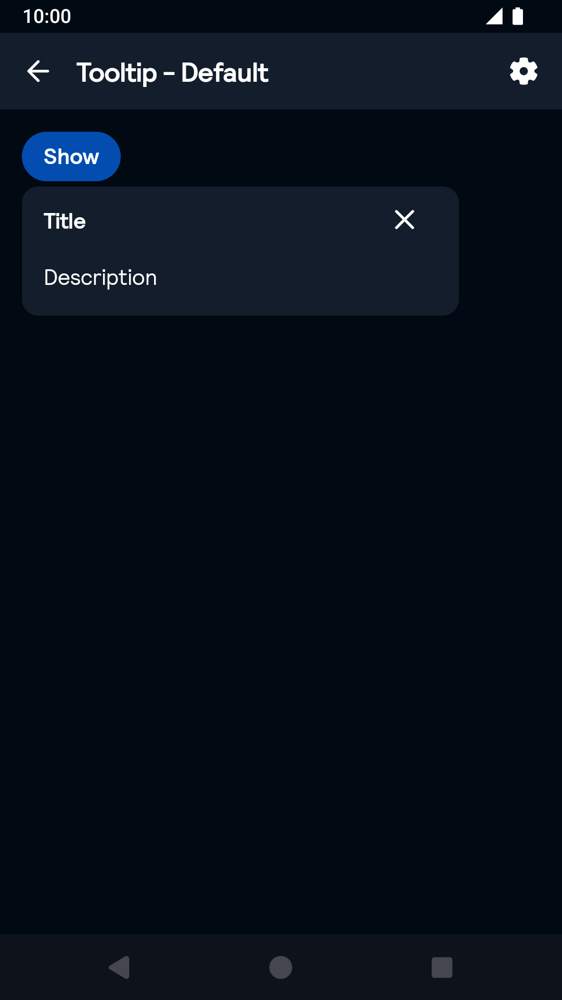

# Tooltip

## Experimental

`BpkTooltip` is experimental and is not published to skyscanner.design. It provides a persistent Rich tooltip that callers show explicitly through `BpkTooltipState`.

Automatic long-press and hover triggers are disabled. The caller owns `show()`.
The focusable persistent popup dismisses on its close control, outside tap, or Back;
each user dismissal dismisses state then invokes the supplied callback once.
`isVisible` remains true during Material3's exit animation, so the component guards the callback
to once per user presentation. A shared Material3 tooltip mutex can cancel this tooltip when
another tooltip shows; that is not a user dismissal and does not invoke the callback. TalkBack
reads title, close button, then text.

### Verification notes

Outside-tap dismissal is validated on device. Robolectric Compose touch injection targets the
Compose root rather than Material3's popup window, so it cannot exercise the popup's outside-tap
dismiss path locally.

```kotlin
@OptIn(ExperimentalBackpackApi::class)
val state = rememberBpkTooltipState()
BpkTooltip(
  title = "Nearby airports",
  text = "Find more options by expanding your airport search.",
  closeAccessibilityLabel = stringResource(R.string.close),
  state = state,
) {
  Anchor()
}
```

Use `BpkTooltipAnchorPosition.BelowEnd` to align a rich tooltip beneath the logical end of its anchor. End alignment follows the reading direction and keeps the popup inside the window. Long titles wrap while preserving the close button’s touch target.

### Example

| Day | Night |
| --- | --- |
|  |  |
